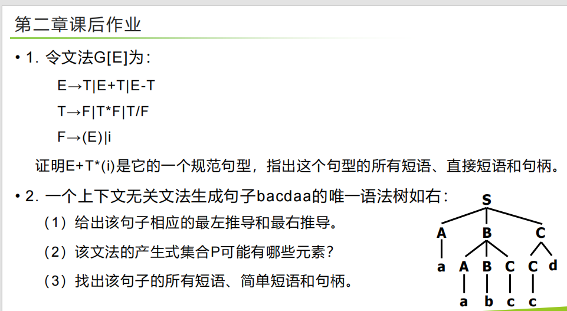

1   区分终结符非终结符，（   ）   ,    等小符号不要漏

2      判断二义性，举例子找句子，，特别注意优先级，结合性，悬空else等

---

## 英文课后习题 (Exercises 2.1 - 2.3)

### **Exercise 2.1**

**1. 题目复述 (Translation):**
给定以下文法：
$S \rightarrow (L) \mid a$
$L \rightarrow L, S \mid S$
为句子 $(a, ((a, a), (a, a)))$ 构造一棵语法树（解析树）。

**2. 解题步骤:**
我们要为目标句子构造一棵自顶向下的语法树 。

* 整个句子被括号包裹，因此根节点必然使用产生式 $S \rightarrow (L)$。
* 内部的符号串是 $a, ((a, a), (a, a))$，这是一个由逗号分隔的序列，匹配 $L \rightarrow L, S$。
* 左侧的 $L$ 最终推导出 $a$。
* 右侧的 $S$ 推导出 $((a, a), (a, a))$，这又需要使用 $S \rightarrow (L)$，依此类推。

**语法树表示如下：**

```text
S
├── (
├── L
│   ├── L
│   │   └── S
│   │       └── a
│   ├── ,
│   └── S
│       ├── (
│       ├── L
│       │   ├── L
│       │   │   └── S
│       │   │       ├── (
│       │   │       ├── L
│       │   │       │   ├── L
│       │   │       │   │   └── S
│       │   │       │   │       └── a
│       │   │       │   ├── ,
│       │   │       │   └── S
│       │   │       │       └── a
│       │   │       └── )
│       │   ├── ,
│       │   └── S
│       │       ├── (
│       │       ├── L
│       │       │   ├── L
│       │       │   │   └── S
│       │       │   │       └── a
│       │       │   ├── ,
│       │       │   └── S
│       │       │       └── a
│       │       └── )
│       └── )
└── )
```

---

### **Exercise 2.2**

**1. 题目复述 (Translation):**
给定以下文法：
$\text{bexpr} \rightarrow \text{bexpr } \mathbf{or} \text{ bterm} \mid \text{bterm}$
$\text{bterm} \rightarrow \text{bterm } \mathbf{and} \text{ bfactor} \mid \text{bfactor}$
$\text{bfactor} \rightarrow \mathbf{not} \text{ bfactor} \mid (\text{bexpr}) \mid \mathbf{true} \mid \mathbf{false}$
为句子 $\mathbf{not} (\mathbf{true} \text{ } \mathbf{or} \text{ } \mathbf{false})$ 构造语法树 。

**2. 解题步骤:**
根据布尔表达式的优先级和文法规则，逐步推导 ：

* 入口是 `bexpr`，向下推导至 `bfactor`，应用包含 `not` 的规则。
* 括号内是一个 `or` 表达式，因此在内部应用 `bexpr or bterm` 的规则。

**语法树表示如下：**

```text
bexpr
└── bterm
    └── bfactor
        ├── not
        └── bfactor
            ├── (
            ├── bexpr
            │   ├── bexpr
            │   │   └── bterm
            │   │       └── bfactor
            │   │           └── true
            │   ├── or
            │   └── bterm
            │       └── bfactor
            │           └── false
            └── )
```

---

### **Exercise 2.3**

**1. 题目复述 (Translation):**
文法 $S \rightarrow aSbS \mid bSaS \mid \varepsilon$ 是二义性的吗？为什么？

**2. 解题步骤:**
**结论：** 该文法是二义性的。

**证明：** 根据定义，如果一个文法存在某个句子对应两棵不同的语法树，或者存在两个不同的最左（右）推导，则该文法是二义的 。我们以生成句子 $abab$ 为例，可以找出两个**不同的最左推导**。

* **最左推导 1：**
  $S \Rightarrow aSbS$
  $\Rightarrow a\varepsilon bS$
  $\Rightarrow abS$
  $\Rightarrow abaSbS$
  $\Rightarrow aba\varepsilon bS$
  $\Rightarrow ababS$
  $\Rightarrow abab\varepsilon$
  $\Rightarrow abab$
* **最左推导 2：**
  $S \Rightarrow aSbS$
  $\Rightarrow a(bSaS)bS$  （这里对第一个非终结符 $S$ 应用了 $S \rightarrow bSaS$）
  $\Rightarrow abSaSbS$
  $\Rightarrow ab\varepsilon aSbS$
  $\Rightarrow abaSbS$
  $\Rightarrow aba\varepsilon bS$
  $\Rightarrow ababS$
  $\Rightarrow abab\varepsilon$
  $\Rightarrow abab$

由于对于同一个句子 $abab$ 存在两个不同的最左推导过程，因此该文法是二义的 。

---

## PPT 课后作业 (Chapter 02, Page 59)



> **📝 教授的温馨提示 (勘误说明):**
> 请仔细观察第2题右侧的语法树。最底层的叶子节点从左到右依次为：$a, a, b, c, c, d$。因此，这棵语法树生成的句子实际上是 **$aabccd$**，而不是题目文本中写的 $bacdaa$。这是一个在多本经典编译原理教材中都出现过的排版印刷错误。为了保证知识点的逻辑正确性，接下来的解答我将严格按照**实际的语法树结构（即句子 $aabccd$）**来进行推导。

### **第 1 题**

**1. 题目复述:**
令文法 $G[E]$ 为：
$E \rightarrow T \mid E+T \mid E-T$
$T \rightarrow F \mid T*F \mid T/F$
$F \rightarrow (E) \mid i$
证明 $E+T*(i)$ 是它的一个规范句型，指出这个句型的所有短语、直接短语和句柄 。

**2. 解题步骤:**
**(1) 证明规范句型：**
规范推导即**最右推导** 。由规范推导所得的句型称为规范句型 。我们对开始符号 $E$ 进行最右推导：
$E \Rightarrow E+T$
$\Rightarrow E+T*F$
$\Rightarrow E+T*(E)$
$\Rightarrow E+T*(T)$
$\Rightarrow E+T*(F)$
$\Rightarrow E+T*(i)$
由于存在这样一个严格的最右推导过程能够得出 $E+T*(i)$，因此证明了 $E+T*(i)$ 是该文法的一个规范句型 。

**(2) 指出短语、直接短语和句柄：**
首先在脑海中（或草稿纸上）构建出该句型的语法树：根为 $E$，派生出 $E, +, T$。这里的 $T$ 派生出 $T, *, F$。这里的 $F$ 派生出 $(, E, )$。括号内的 $E$ 派生出 $T$，进而派生出 $F$，最终派生出 $i$ 。

**短语 (Phrases):** 语法树中每棵子树的末端结点构成相对于子树根的短语 。包含：

* $i$ （对应 $F \rightarrow i$, $T \stackrel{*}{\Rightarrow} i$, $E \stackrel{*}{\Rightarrow} i$）
* $(i)$ （对应 $F \stackrel{*}{\Rightarrow} (i)$）
* $T*(i)$ （对应 $T \stackrel{*}{\Rightarrow} T*(i)$）
* $E+T*(i)$ （对应 $E \stackrel{*}{\Rightarrow} E+T*(i)$）
* 

**直接短语 (Direct phrases):** 只有两层子树（即直接应用一步产生式得到）的末端节点构成的短语 。观察可知，只有底部的 $i$ 是直接由 $F \rightarrow i$ 一步推导出的末端符号串。

* $i$

**句柄 (Handle):** 句型中最左边的直接短语 。

* $i$

---

### **第 2 题**

**1. 题目复述:**
一个上下文无关文法生成句子 $aabccd$ (已勘误) 的唯一语法树如右图所示。
(1) 给出该句子相应的最左推导和最右推导。
(2) 该文法的产生式集合 $P$ 可能有哪些元素？
(3) 找出该句子的所有短语、简单短语（直接短语）和句柄 。

**2. 解题步骤:**

**(1) 最左推导与最右推导**

* **最左推导 (每次替换最左边的非终结符)：**
  $S \Rightarrow ABC$
  $\Rightarrow aBC$
  $\Rightarrow aABCC$
  $\Rightarrow aaBCC$
  $\Rightarrow aabCC$
  $\Rightarrow aabcC$
  $\Rightarrow aabcCd$
  $\Rightarrow aabccd$
* **最右推导 (每次替换最右边的非终结符)：**
  $S \Rightarrow ABC$
  $\Rightarrow ABCd$
  $\Rightarrow ABcd$
  $\Rightarrow A(ABC)cd$
  $\Rightarrow AABccd$
  $\Rightarrow AAbccd$
  $\Rightarrow Aabccd$
  $\Rightarrow aabccd$

**(2) 产生式集合 $P$ 可能的元素**
观察语法树中的父子节点连接关系，可以提取出所有被使用过的产生式规则 ：
$S \rightarrow ABC$
$B \rightarrow ABC$
$C \rightarrow Cd$
$A \rightarrow a$
$B \rightarrow b$
$C \rightarrow c$

**(3) 短语、简单短语（直接短语）和句柄**
基于给定语法树中所有子树的叶子节点进行分析 ：

* **短语 (Phrases):**
* $a$ （第一个 $A$ 对应的）
* $a$ （第二个 $A$ 对应的）
* $b$ （内部 $B$ 对应的）
* $c$ （第一个 $C$ 对应的）
* $c$ （第二个 $C$ 对应的）
* $abc$ （中间的子树 $B \rightarrow ABC$ 对应的末端节点）
* $cd$ （右侧子树 $C \rightarrow Cd$ 对应的末端节点）
* $aabccd$ （根节点 $S$ 对应的）
* 

**简单短语/直接短语 (Simple phrases):** (对应高度为 1 的子树叶节点)

* $a$ （第一个）
* $a$ （第二个）
* $b$
* $c$ （第一个）
* $c$ （第二个）
* 

**句柄 (Handle):** (最左边的简单短语)

* 第一个 $a$
