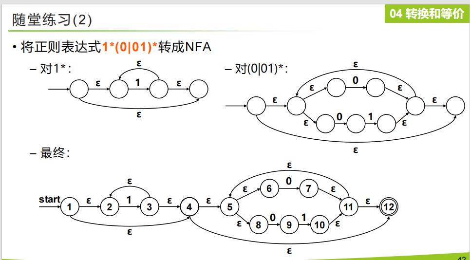
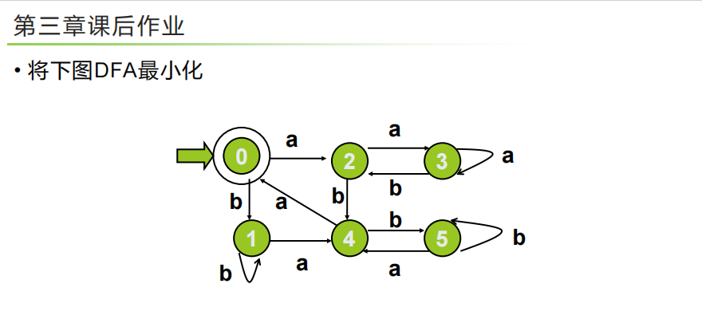

正则  NFA   DFA
注意 ：写start和开始箭头  最后接受态画圈  空字符边数  箭头标准


### **Exercise 3.1**

> **题目要求：**
> Give the recognized tokens of the following program in Pascal.
> （写出下列 Pascal 程序识别出的词法单元/tokens。）
>
> ```pascal
> function max(i, j: integer): integer;
> {return the maximum of integers i and j}
> begin
>     if i > j then max := i else max := j
> end;
> ```

**解答步骤：**
根据 PPT 第3页的定义 ，词法分析器会将源程序分解为 `<类别, 属性值>` 形式的 token。在扫描过程中，注释（由 `{}` 包裹的部分）和空白符会被丢弃 。

按照从左到右的最长匹配原则 ，识别出的 Token 序列如下：

* `<keyword, function>`
* `<id, max>`
* `<symbol, (>`
* `<id, i>`
* `<symbol, ,>`
* `<id, j>`
* `<symbol, :>`
* `<keyword, integer>`
* `<symbol, )>`
* `<symbol, :>`
* `<keyword, integer>`
* `<symbol, ;>`
* *(注释 `{return the...}` 被丢弃)*
* `<keyword, begin>`
* `<keyword, if>`
* `<id, i>`
* `<op, >>`
* `<id, j>`
* `<keyword, then>`
* `<id, max>`
* `<op, :=>`
* `<id, i>`
* `<keyword, else>`
* `<id, max>`
* `<op, :=>`
* `<id, j>`
* `<keyword, end>`
* `<symbol, ;>`

---

### **Exercise 3.2**

> **题目要求：**
> Describe the languages denoted by the following regular expressions:
> （描述下列正则表达式所表示的语言集合：）
>
> * `a(a|b)*a`
> * `a*ba*ba*ba*`

**解答步骤：**
根据 PPT 中正规式的定义及运算规则 ：

1. **`a(a|b)*a`**：

* 描述：字母表 $\{a, b\}$ 上，所有**以 `a` 开头且以 `a` 结尾，并且总长度至少为2**的字符串构成的集合。

2. **`a*ba*ba*ba*`**：

* 描述：字母表 $\{a, b\}$ 上，所有**恰好包含3个 `b**` 的字符串构成的集合（`b` 之间或两端可以有任意多个 `a`）。

---

### **Exercise 3.3**

> **题目要求：**
> Show how to write a regular expression for a keyword in a case insensitive language. Illustrate your idea by writing the expression for `SELECT` in SQL.
> （说明如何为大小写不敏感（case insensitive）语言中的关键字编写正则表达式。以 SQL 中的关键字 `SELECT` 为例来说明你的想法。）

**解答步骤：**
在大小写不敏感的语言中，关键字的每一个字符既可能是大写也可能是小写。根据正则表达式的结合律和范围选择特性 ，我们可以使用 `|`（或）运算符将每个字母的大写和小写形式并列起来。

对于 SQL 关键字 `SELECT`，正则表达式可以写为：
`(s|S)(e|E)(l|L)(e|E)(c|C)(t|T)`

为了更简洁，通常我们也会使用字符范围缩写（shorthand）的形式表示 ：
`[sS][eE][lL][eE][cC][tT]`

---

### **Exercise 3.4**

> **题目要求：**
> Given the following regular expression `1*(0|01)*`
> (1) Transform it to an equivalent finite automaton.
> (2) Construct an equivalent DFA for the result of exercise (1).
> (3) Reduce the result of (2) and get a reduced DFA.
> （给定正则表达式 `1*(0|01)*`，完成：1. 转换为等价的 NFA；2. 构造等价的 DFA；3. 将 DFA 最小化。）

**解答步骤：

**

**(1) 转换为等价的 NFA**

**汤普森构造法：**


---

### **Exercise 3.5**

> **题目要求：**
> Given the alphabet $\Sigma = \{ z, o, / \}$, a comment in a program over $\Sigma$ begins with `/o` and ends with `o/`. Embedded comments are not permitted.
> (1) Draw a DFA that recognizes nothing but all the comments in the source programs.
> (2) Write a single regular expression that exactly describes all the comments in the source programs.
> （给定字母表 $\Sigma = \{ z, o, / \}$，不允许嵌套，注释以 `/o` 开始，以 `o/` 结束。1. 绘制识别注释的 DFA；2. 编写描述注释的单一正则表达式。）

**解答步骤：**

**(1) DFA 构造 (通过状态转移表说明)**
我们需要设立 5 个有效状态和一个死状态（$S_{err}$）：

* $S_0$：初始状态
* $S_1$：已识别出左斜杠 `/`
* $S_2$：已识别出完整开头 `/o`，处于注释内部
* $S_3$：在注释内部遇到了字母 `o`，它可能是结尾的预兆
* $S_4$：已识别出完整结尾 `o/`，为**接受状态**

**DFA 转换表：**

| 状态                                                                                                                                                           | 输入`/`   | 输入`o`   | 输入`z`   |
| -------------------------------------------------------------------------------------------------------------------------------------------------------------- | ----------- | ----------- | ----------- |
| **$S_0$** (Start)                                                                                                                                      | $S_1$     | $S_{err}$ | $S_{err}$ |
| **$S_1$**                                                                                                                                              | $S_{err}$ | $S_2$     | $S_{err}$ |
| **$S_2$** (Inside)                                                                                                                                     | $S_2$     | $S_3$     | $S_2$     |
| **$S_3$** (End pre)                                                                                                                                    | $S_4$     | $S_3$     | $S_2$     |
| **$S_4$** (Accept)                                                                                                                                     | $S_{err}$ | $S_{err}$ | $S_{err}$ |
| *(说明：在 $S_3$ 状态下如果继续输入 `o`，仍然停留在 $S_3$ 等待可能出现的 `/`；如果输入 `z`，则说明之前的 `o` 只是普通内容，退回 $S_2$ 状态。)* |             |             |             |

**(2) 正则表达式的编写**
注释必须以 `/o` 开始，以 `o/` 结束。
要保证不允许嵌套且能正确结束，**注释中间的内容绝不能出现序列 `o/**`。
这意味着，注释中间的任何字符 `o` 后面，要么跟着 `z`，要么跟着另一个 `o`（直到最终接上结尾的 `/`）。
标准的表达式写法如下：

`/o(z|/|o+(z|/))*o+/`

**逻辑解析：**

* `/o` 匹配必需的起始符。
* `(z|/|o+(z|/))*` 匹配内部安全的内容。这段表示：要么是安全的普通字符（`z` 或 `/`），要么是一组 `o` 之后紧跟着一个安全的字符（`z` 或 `/`）。这彻底阻断了 `o` 直接后跟 `/` 的可能性。
* `o+/` 匹配结尾处的一个或连续多个 `o` 加上最终的 `/`。


没问题，我们继续！这道题是关于**DFA的最小化**，这是词法分析中非常核心且经常作为大题出现的考点。

我们严格按照你在 PPT（比如第51和52页）中学到的划分等价类（Hopcroft算法）步骤来进行解答。

---

### **第三章课后作业**

> **题目要求：**
> 将下图 DFA 最小化。
> 

为了解题清晰，我们首先把图片中 DFA 的状态转移逻辑提取出来。

* **初始状态**：0
* **终态（接受状态）**：0 （双圈）
* **非终态**：1, 2, 3, 4, 5

**初始状态转移表：**

| 当前状态           | 输入 a | 输入 b |
| ------------------ | ------ | ------ |
| **0** (终态) | 2      | 1      |
| **1**        | 4      | 1      |
| **2**        | 3      | 4      |
| **3**        | 3      | 2      |
| **4**        | 0      | 5      |
| **5**        | 4      | 5      |

---

### **解答步骤**

**Step 1: 将状态分成非终态和终态集**
首先，根据是否为接受状态，将所有状态划分为两个初始子集：

* 终态集：`{0}`
* 非终态集：`{1, 2, 3, 4, 5}`

**Step 2: 寻找子集中不等价状态（逐步细化划分）**

我们需要检查同一个集合内的状态，在接受相同的输入字符（`a` 或 `b`）时，是否会跳转到**不同**的集合。如果跳转到不同的集合，说明它们不等价，必须拆分。

**第一次拆分：检查 `{1, 2, 3, 4, 5}**`
我们来看它们在输入 `a` 时的去向：

* 1 遇 `a` $\rightarrow$ 4 (属于 `{1, 2, 3, 4, 5}`)
* 2 遇 `a` $\rightarrow$ 3 (属于 `{1, 2, 3, 4, 5}`)
* 3 遇 `a` $\rightarrow$ 3 (属于 `{1, 2, 3, 4, 5}`)
* **4 遇 `a` $\rightarrow$ 0 (属于 `{0}`)**
* 5 遇 `a` $\rightarrow$ 4 (属于 `{1, 2, 3, 4, 5}`)

由于只有状态 4 跳转到了终态集 `{0}`，它的行为与其他人不同，所以把 4 独立出来。
当前划分变为：`{0}`, `{4}`, `{1, 2, 3, 5}`

**第二次拆分：检查 `{1, 2, 3, 5}**`
我们再来看这个新集合在输入 `a` 时的去向：

* 1 遇 `a` $\rightarrow$ 4 (属于 `{4}`)
* 5 遇 `a` $\rightarrow$ 4 (属于 `{4}`)
* **2 遇 `a` $\rightarrow$ 3 (属于 `{1, 2, 3, 5}`)**
* **3 遇 `a` $\rightarrow$ 3 (属于 `{1, 2, 3, 5}`)**

状态 1 和 5 去了集合 `{4}`，而状态 2 和 3 留在了本集合内部，行为不同，因此需要切分开。
当前划分变为：`{0}`, `{4}`, `{1, 5}`, `{2, 3}`

**第三次拆分：分别检查 `{1, 5}` 和 `{2, 3}**`

* **先查 `{1, 5}`：**
* 输入 `a`：1 去 4，5 去 4。都去 `{4}`，一致。
* 输入 `b`：1 去 1，5 去 5。都去 `{1, 5}`，一致。
* 结论：`{1, 5}` 无法继续拆分，它们是等价的！
* **再查 `{2, 3}`：**
* 输入 `a`：2 去 3，3 去 3。都去 `{2, 3}`，一致。
* 输入 `b`：**2 去 4 (属于 `{4}`)**，**3 去 2 (属于 `{2, 3}`)**。去向不同，必须拆分！
  当前划分变为：`{0}`, `{4}`, `{1, 5}`, `{2}`, `{3}`

**Step 3: 确定最终状态集**
目前包含了多个状态的集合只剩下 `{1, 5}`，并且我们在上面已经证明了它们是等价的，无法再拆。
因此，最终的等价类划分结果为：
`{0}`、 `{1, 5}`、 `{2}`、 `{3}`、 `{4}`

---

**Step 4: 构造最小化后的 DFA**

我们将等价类 `{1, 5}` 合并为一个新状态（可以命名为 `15`，或者直接用其中一个数字代替）。为方便展示，我们用大写字母代表合并后的新状态节点：

* **A** = `{0}` （初始状态 & 接受状态）
* **B** = `{1, 5}`
* **C** = `{2}`
* **D** = `{3}`
* **E** = `{4}`

**最小化后的 DFA 转换表如下：**

| 最小化状态            | 输入 a | 输入 b |
| --------------------- | ------ | ------ |
| **A** (初/终态) | C      | B      |
| **B**           | E      | B      |
| **C**           | D      | E      |
| **D**           | D      | C      |
| **E**           | A      | B      |

*(注：表中的转换逻辑是直接代入原状态得来的。例如，对于状态 B `{1, 5}`，输入 `a` 时，原状态 1 和 5 都指向 4，而 4 对应新状态 E，所以 B 遇 `a` 到 E。以此类推。)*
